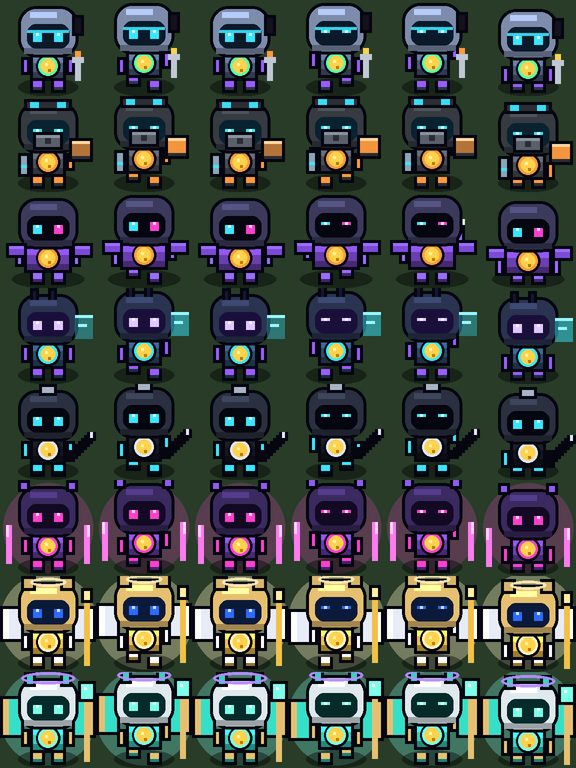

# Bombers Overhaul 2.0

Cada operador é uma classe de combate com habilidades, comportamento de IA e visual próprios. São **8 BOMBERS**: Lyra, Kai, Titan, Vex, Kira, Jax, Orion e Aeon. Nada aqui altera preços, recompensas por baú/inimigo, tokenomics, servidor ou programa Solana.

## Arquitetura
Código novo em `client/src/game/`. Os módulos de lógica **não importam Phaser nem têm estado global**, então são testáveis em Node:

| Arquivo | Papel |
|---|---|
| `bomberTypes.ts` | Tipos (`Modifiers`, `AbilityDef`, `AbilityRuntime`, `CellTarget`, `WorldView`) e o mapa raridade → classe |
| `bomberConfig.ts` | **Todos os números**: `LIMITS`, `BALANCE`, `ABILITY_DEFS`, `AI_WEIGHTS`, `AI_TUNING` |
| `bomberCombat.ts` | Stamina segura, crítico, combo, dano por tipo de alvo, geometria da explosão, PRNG com semente |
| `bomberAbilities.ts` | Estado temporário, recargas, modificadores limitados, condições de ativação, Pulso de Reparo, auras |
| `bomberAI.ts` | BFS único, candidatos, escolha de alvo com permanência, lista negra, detecção de preso, checagem de fuga |
| `bomberFx.ts` | Pool de imagens e textos (única parte com Phaser) |

`FarmScene.ts` só executa: monta a foto do mapa, pergunta à IA, aplica dano e desenha. O tempo das habilidades avança em um único lugar (`update`), sem timer por personagem.

## Habilidades
| Classe (raridade) | Passiva | Ativa (libera no Nv 3) | Recarga | Duração | Custo |
|---|---|---|---|---|---|
| Lyra (Comum) | Bombas custam −15% de stamina; regen. em campo +25% | **Pulso de Reparo**: +20% da própria stamina (se ≤ 50%) e +0,8 a até 3 aliados a ≤ 4 tiles | 22 s | instantâneo | 0 |
| Kai (Incomum) | +25% de dano em inimigos; prefere inimigos a até 6 passos antes dos baús | **Marca de Caça**: +35% de dano em inimigos (soma ao passivo) e +15% de velocidade | 14 s | 5 s | 0,5 |
| Titan (Raro) | +25% de dano em baús, +30% em blocos resistentes | **Impacto Sísmico**: próxima bomba com +1 de alcance e diagonais | 16 s | até 6 s (armada) | 2 |
| Vex (Épico) | Vê o valor dos baús a 6 tiles (outros: 4); +0,25 de sorte | **Varredura Profunda**: alcance 8 e +0,35 de sorte | 20 s | 5 s | 0,5 |
| Kira (Mítico) | +5% de velocidade; prefere caminhos curtos | **Impulso**: +50% de velocidade | 12 s | 3 s | 0,5 |
| Jax (Lendário) | 8% de crítico (x1,75); 3º golpe seguido +50% | **Tempestade de Lâminas**: golpes 2x mais frequentes, +10% de crítico | 15 s | 3 s | 0 |
| Orion (Super) | +10% de dano, +5% de velocidade, +0,2 de sorte; aliados a 4 tiles +3% de dano | **Ascensão** (Nv 8): +25% de dano, +20% de velocidade, +0,2 de sorte; aliados a 5 tiles +7% de dano e +5% de velocidade | 45 s | 6 s | 2 |
| **Aeon (Ancestral)** | +12% de dano, +6% de velocidade, bombas −10% de stamina, +0,2 de sorte, enxerga baús a 7 tiles; aliados a 5 tiles +3% de dano e +2% de velocidade | **Reescrita da Grade** (Nv 10): +25% de dano, +15% de velocidade, +1 de alcance, +0,2 de sorte; aliados a 6 tiles +6% de dano, +5% de velocidade e 15% das recargas encurtadas | 60 s | 8 s | 3 |

Condições de ativação (automáticas): Kai com um inimigo por perto; Aeon com 40%+ de stamina e 3+ alvos, um inimigo ou 2+ baús detectados; Lyra com stamina ≤ 50% ou aliado cansado por perto; Titan ao lado de um alvo resistente ou com 3+ alvos a 2 passos; Vex com 2+ baús detectados; Kira com caminho de 4+ passos; Jax ao lado de um alvo; Orion com 40%+ de stamina e 3+ alvos ou um inimigo por perto.

### Limites (aplicados a tudo, venha de onde vier)
Dano ×0,5–2; velocidade ×0,6–1,6; regen. ×0,5–2; custo ×0,5–1,5; crítico ≤ 35% (x1–2,5); **bônus** de sorte ≤ +0,6 (a sorte base e as melhorias seguem como antes); bônus de equipe ≤ 10%; alcance da bomba ≤ 5 (a bomba comum continua ≤ 4); duração ≤ 10 s; recarga ≥ 5 s e sempre maior que a duração (sem sobreposição). Passo mínimo de 80 ms.

### Por que não há stamina infinita nem dano repetido
- Pulso de Reparo: recarga de 22 s; cada aliado só recebe um reparo por 30 s, **não importa quantas Lyras existam**; nada passa do máximo. Testado com 1 h simulada.
- Jax: intervalo mínimo de 120 ms entre golpes (o teste tenta golpear a cada 1 ms), custo de stamina por golpe e alvo validado a cada golpe.
- Sincronia do Aeon: só encurta recargas que ainda correm, nunca abaixo de zero, cada aliado uma vez a cada 45 s (vários Aeons não somam). Testado com 1 h simulada.
- Baú/inimigo já destruído é ignorado em `hitChest`/`hitEnemy`: uma recompensa por alvo.
- As habilidades **nunca** chamam `addReward`: não geram $BOMBERSI por conta própria.

## IA
Uma decisão = um BFS que dá a distância até todos os alvos. A categoria domina (**baú > inimigo > bloco**, como na 1.7.1) e os pesos da classe decidem dentro dela: Titan prefere alvos resistentes, Vex o baú de maior valor esperado, Kira o mais próximo, Jax a posição com mais alvos adjacentes e o golpe de misericórdia, Lyra evita gastar o resto da stamina em blocos, Orion pondera valor e MVP.
- **Permanência:** o alvo só muda se aparecer categoria superior, ou se outro for melhor por uma margem depois de 1,5 s e o atual ainda não estiver ao alcance.
- **Inalcançável:** 10 decisões sem se aproximar → lista negra por 8 s.
- **Preso:** 16 decisões de movimento por no máximo 3 células → larga o alvo e dá um passo aleatório.
- **Segurança:** antes de plantar, precisa existir saída da zona de explosão dentro do pavio; se não existir, espera até 3 decisões e planta mesmo assim (na 1.7.1 a bomba não fere operadores).
- Alvos em zona de bomba, alvos destruídos e duas bombas na mesma célula são evitados.

## Salvamento
- Chave `bomber-idle:v1`, formato antigo válido. Único campo novo: `st` (estatísticas) por operador, opcional.
- Habilidades ativas, recargas e bônus **não são salvos**. Ao carregar, ativas começam com 30% da recarga. O relógio do cliente não é usado para nada disso (só o tempo de frame).
- Validação ao carregar: raridade ou número de série inválidos descartam o item; XP, nível, melhorias, jitter, stamina e contadores inválidos (NaN, Infinity, negativo, fora da faixa) viram valores seguros. Stamina ausente/inválida usa o padrão da 1.7.1 (cheia).

## Balanceamento: o que foi medido
Simulador headless (`npm run smoke -w client`, cena real com mock do Phaser; 15 operadores por 480 s simulados, mesma semente de ruído da cena):

| Cenário | Renda 1.7.1 | Renda 2.0 | Blocos | Baús |
|---|---|---|---|---|
| Mapa 1 (10 amostras) | 225,6 mil ± 59 mil | 227,0 mil ± 42 mil | 1.203 → 1.365 | 60 → 67 |
| Mapa 46, inst. 30 (8 amostras) | 373 mil ± 105 mil | 408 mil ± 77 mil | 242 → 228 | 110 → 108 |

(Média ± desvio padrão.) A renda é **estatisticamente equivalente** nas duas amostras, mas o ruído é grande (inimigos pagam muito) e o simulador não tem rede, alojamentos nem Zelador. No mapa inicial a nova IA quebra ~13% mais blocos com as mesmas bombas. **Hipótese a confirmar em jogo real:** o ganho por posicionamento pode somar ao dos bônus de classe; se a renda subir demais, ajuste `AI_WEIGHTS.*.cluster` e os bônus em `ABILITY_DEFS`.

## Testes
- `npm test -w client`: 61 testes (11 originais + 50 novos). Sem rede: `tsx --test client/test/*.test.ts`.
- `npm run smoke -w client`: cena real sem navegador. Falha em exceção, stamina fora da faixa, operador dentro de bloco ou baú pago em duplicidade.

## Limites conhecidos
- Nada foi visto num navegador: renderização, animações, tamanho dos efeitos e a API real do Phaser **não** foram validados (o smoke usa mock). Teste visual manual é o próximo passo.
- Não há dano a operadores na 1.7.1, então "animação de dano" não foi criada (seria uma mecânica nova).
- Uma árvore de especialização exigiria mudar o save; foi adiada.

## Raridades, cápsula e cartas
- Operadores: 8 raridades (Comum, **Incomum**, Raro, Épico, Mítico, Lendário, Super lendário, **Ancestral**). Os **baús** continuam com as 6 de antes: Incomum e Ancestral só existem como operadores, então a economia dos baús não muda.
- Cápsula: Raro a Super lendário iguais a 1.7.1; os 55% do Comum viraram Comum 41,9%, Incomum 13% e Ancestral 0,1%. **Hipótese**: sem dados reais, o Ancestral custa em média ~1.000 cápsulas (30 milhões, contra ~6 milhões do Super). Ajuste `CAPSULE_ODDS` em `state.ts`.
- Cartas: `client/public/nft/{aeon,kai}.jpg`, `_card.webp` e `_face.webp`, no mesmo padrão dos demais.
- O Aeon é o maior em poder, stamina, sorte, multiplicador e baús; a Kira continua a mais veloz. Em time misto (480 s) o Aeon tem atividade parecida com a do Orion e ganha mais por baú (multiplicador 3 x 2,5 contra 2,5 x 2); o Kai fica entre a Lyra e o Vex. O Titan segue como o mais fraco, como na 1.7.1.
- Servidor (`server/src/game/types.ts`) já declarava só 4 raridades e **não foi alterado**: ao ligar a economia on-chain, ele precisa aprender as 8.
